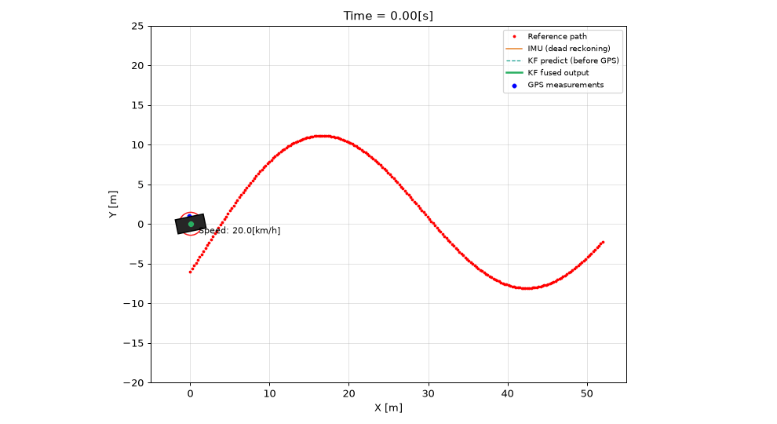

# Loose-Coupled Kalman Filter — Car Trajectory Following

Educational **Python simulation**: a car follows a reference path while a **loose-coupled Kalman filter (LCKF)** estimates position by fusing **IMU** (high rate) and **GPS** (low rate).

**Filter core forked from:** [Bee1997/LooseCoupled-KalmanFilter](https://github.com/Bee1997/LooseCoupled-KalmanFilter) (MIT). This repo adds the **car model**, **path following**, and **live plot**.

## Demo



## In short

| | |
|---|---|
| **Goal** | Follow a reference trajectory and show how LCKF navigation works |
| **Inputs** | **IMU** @ 100 Hz (acceleration from vehicle motion) · **GPS** @ 10 Hz (noisy x, y fixes) |
| **Output** | **Fused position** (green track) — smoother than raw GPS, corrected vs IMU drift |
| **Plant** | Bicycle-model car + pure pursuit on the reference path (separate from the filter) |

## Quick start

```powershell
pip install -r requirements.txt
python main.py
```

A Matplotlib window animates the run: reference path, GPS dots, IMU dead reckoning, KF predict, and fused estimate.

## What you see on the plot

| Color | Meaning |
|--------|---------|
| Red dots | Reference path to follow |
| Blue dots | GPS measurements (noisy) |
| Orange line | IMU-only dead reckoning (drifts between GPS fixes) |
| Cyan dashed | Kalman **predict** (after IMU, before GPS) |
| Green line | Kalman **fused** output (after GPS updates) |
| Black rectangle | True car pose (controller uses true state; filter runs in parallel) |
| Red ellipse | 2σ position uncertainty from covariance **P** |

## How the filter runs

1. **Predict (every IMU step):** integrate IMU acceleration into velocity and position; propagate **P** with **Q**.
2. **Update (every GPS fix):** correct position with noisy GPS using **R**; velocity stays tied to IMU (loose coupling).

Tuning: `lckf_config.py` — `FS_IMU`, `FS_GPS`, `Q`, `R`, `GPS_MEAS_STD`.

## Files

| File | Role |
|------|------|
| `main.py` | Entry point |
| `capture_demo_gif.py` | Regenerate `docs/lckf_car_demo.gif` for the README |
| `KalmanFilter.py` | LCKF (adapted from Bee1997) |
| `car_lckf_sim.py` | Simulation loop |
| `car_world.py` | Reference path, car model, pure pursuit |
| `car_visualization.py` | Animation |
| `lckf_config.py` | Rates and noise |

## Credit & license

- Kalman filter based on [LooseCoupled-KalmanFilter](https://github.com/Bee1997/LooseCoupled-KalmanFilter) by **Bee1997** (MIT).
- Car simulation and visualization: **Muhammad Rafay** (MIT — see `LICENSE`).

**Disclaimer:** Software-only demo for learning. Not for safety-critical or production navigation.
